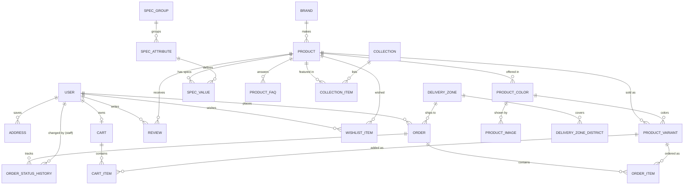

# MobiGo — Database Schema & Relationships

**Target:** PostgreSQL 16 with the Prisma ORM (7+). Money is stored as **integer BDT** (৳, no fractional poisha in retail). IDs are `cuid()` strings (project convention; see §4). Every timestamp is `timestamptz` (`@db.Timestamptz(3)`), never plain `timestamp`. Every table has `createdAt` and `updatedAt`.

Related: [PRD](./PRD.md) · [Design System](./DESIGN_SYSTEM.md)

---

## 1. Entity-Relationship Diagram



`Banner`, `Page`, `Outlet` and `Setting` are standalone content tables with no foreign keys.

## 2. Relationship Summary

| Relationship | Cardinality | Notes |
|---|---|---|
| Brand → Product | 1 : N | A phone belongs to exactly one brand. `onDelete: Restrict`, so a brand with products cannot be deleted. |
| Product → ProductColor | 1 : N | Example: "Cobalt Violet". Holds the swatch hex. |
| ProductColor → ProductImage | 1 : N | Each color has its own gallery. This drives the gallery swap when a color is selected. |
| Product → ProductVariant | 1 : N | **The sellable unit (SKU).** One row per color × RAM/storage combination. Holds the price, compare-at price and stock. |
| ProductColor → ProductVariant | 1 : N | The variant's color. A composite FK (`colorId`, `productId`) guarantees the color belongs to the same product. Unique on (`productId`, `colorId`, `ramGb`, `storageGb`, `warrantyType`). |
| SpecGroup → SpecAttribute | 1 : N | Example: Display → Size, Type, Refresh rate. |
| Product ↔ SpecAttribute via **SpecValue** | M : N | EAV-style spec sheet. Typed filter columns are denormalized onto Product (see §4). |
| Collection ↔ Product via **CollectionItem** | M : N | Home shelves ("Best Deals"), each with a `position`. |
| User → Cart → CartItem → ProductVariant | 1 : 0..1 : N : 1 | The guest cart lives in localStorage and is merged on login. |
| User → Order | 1 : N (nullable) | `userId` is nullable to allow **guest checkout**. |
| auth.users → User | 1 : 0..1 (no FK) | `User.id` = Supabase `auth.users.id` (UUID). The profile row is created on first sign-in (see §8). |
| Order → OrderItem → ProductVariant | 1 : N : 1 | OrderItem **snapshots** the name, variant label, SKU and unit price, so later catalog edits never change past orders. |
| Order → OrderStatusHistory | 1 : N | An audit trail of every status change, with an optional `changedById` (staff). |
| DeliveryZone → Order | 1 : N | Sets the delivery fee. The fee is also snapshotted on the order. |
| DeliveryZone → DeliveryZoneDistrict | 1 : N | Each district maps to exactly one zone (the district is the primary key). |
| User ↔ Product via **WishlistItem** | M : N | Unique on (`userId`, `productId`). |
| User → Review ← Product | N : 1 each | One review per user per product. Moderated through `status`. |

## 3. Prisma Schema

```prisma
generator client {
  provider = "prisma-client"
  output   = "../src/generated/prisma"
}

// Prisma 7+: the connection URL lives in prisma.config.ts, not here.
// The CLI (migrate) uses the DIRECT url; the app uses the POOLED url through a driver adapter. See §7.
datasource db {
  provider = "postgresql"
}

// ───────────────────────── Enums ─────────────────────────

enum Role {
  CUSTOMER
  STAFF
  ADMIN
}

enum ProductStatus {
  DRAFT
  ACTIVE
  PREORDER
  DISCONTINUED
}

enum NetworkType {
  G4
  G5
}

enum WarrantyType {
  OFFICIAL
  UNOFFICIAL
}

enum OrderStatus {
  PENDING
  CONFIRMED
  SHIPPED
  DELIVERED
  CANCELLED
  RETURNED
}

enum PaymentMethod {
  COD // MVP: only option. Online methods added later (see §6).
}

enum PaymentStatus {
  UNPAID
  PAID // set by staff when the courier remits COD cash
}

enum ReviewStatus {
  PENDING
  APPROVED
  REJECTED
}

enum BannerPlacement {
  HERO
  HERO_SIDE
  HOME_MID
  PROMO_MODAL
}

// ───────────────────────── Users ─────────────────────────

// Profile for a Supabase Auth user. id = auth.users.id (UUID), set from the session on first
// sign-in, never generated here. Credentials, sessions and OTP live in Supabase Auth.
// Authorization (role, isActive) lives here, never in Supabase user_metadata.
model User {
  id           String    @id @db.Uuid
  name         String
  phone        String?   @unique // BD format 01XXXXXXXXX (CHECK in §5); copied from Auth or checkout
  email        String?   @unique // stored lowercased (CHECK in §5); copied from Auth
  role         Role      @default(CUSTOMER)
  isActive     Boolean   @default(true)
  lastLoginAt  DateTime? @db.Timestamptz(3)
  createdAt    DateTime  @default(now()) @db.Timestamptz(3)
  updatedAt    DateTime  @updatedAt @db.Timestamptz(3)

  addresses      Address[]
  cart           Cart?
  orders         Order[]
  reviews        Review[]
  wishlist       WishlistItem[]
  statusChanges  OrderStatusHistory[] @relation("StatusChangedBy")

  // At least one of phone or email is required (CHECK user_has_login, §5).
}

model Address {
  id          String   @id @default(cuid())
  userId      String   @db.Uuid
  label       String?  // "Home", "Office"
  fullName    String
  phone       String
  division    String
  district    String
  area        String
  addressLine String
  isDefault   Boolean  @default(false)
  createdAt   DateTime @default(now()) @db.Timestamptz(3)
  updatedAt   DateTime @updatedAt @db.Timestamptz(3)

  user User @relation(fields: [userId], references: [id], onDelete: Cascade)

  @@index([userId])
}

// ───────────────────────── Catalog ─────────────────────────

model Brand {
  id          String   @id @default(cuid())
  name        String   @unique
  slug        String   @unique
  logoUrl     String?
  description String?
  isFeatured  Boolean  @default(false)
  sortOrder   Int      @default(0)
  createdAt   DateTime @default(now()) @db.Timestamptz(3)
  updatedAt   DateTime @updatedAt @db.Timestamptz(3)

  products Product[]
}

model Product {
  id               String        @id @default(cuid())
  brandId          String
  name             String        // "Galaxy S26 Ultra 5G"
  slug             String        @unique
  modelNumber      String?
  shortDescription String?
  description      String?       // rich text / HTML (sanitized)
  status           ProductStatus @default(DRAFT)
  releaseDate      DateTime? @db.Timestamptz(3)
  warrantyInfo     String?

  // Denormalized from variants & specs, kept in sync on write → fast listing filters/sort
  minPrice         Int           @default(0)
  maxPrice         Int           @default(0)
  maxSaving        Int           @default(0)
  inStock          Boolean       @default(false)
  network          NetworkType?
  displaySizeIn    Decimal?      @db.Decimal(3, 1) // 6.9
  batteryMah       Int?
  chipsetBrand     String?       // "Snapdragon", "Apple", "MediaTek"
  ramOptionsGb     Int[]         // e.g. {12,16}
  storageOptionsGb Int[]         // e.g. {256,512,1024}
  brandName        String        // copy of Brand.name for full-text search; updated when the brand is renamed

  // Generated tsvector column; the expression lives in the migration SQL (§5).
  // @default(dbgenerated()) stops Prisma from emitting "DROP DEFAULT" against the generated column.
  search           Unsupported("tsvector")? @default(dbgenerated())

  // SEO
  metaTitle        String?
  metaDescription  String?

  ratingAvg        Decimal       @default(0) @db.Decimal(2, 1)
  ratingCount      Int           @default(0)
  createdAt        DateTime      @default(now()) @db.Timestamptz(3)
  updatedAt        DateTime      @updatedAt @db.Timestamptz(3)

  brand        Brand            @relation(fields: [brandId], references: [id], onDelete: Restrict)
  colors       ProductColor[]
  variants     ProductVariant[]
  specs        SpecValue[]
  faqs         ProductFaq[]
  reviews      Review[]
  collections  CollectionItem[]
  wishlistedBy WishlistItem[]

  @@index([brandId])
  @@index([status, minPrice])
  @@index([status, createdAt])
  @@index([ramOptionsGb], type: Gin)
  @@index([storageOptionsGb], type: Gin)
  @@index([search], type: Gin)
  @@index([name(ops: raw("gin_trgm_ops"))], type: Gin, map: "product_name_trgm_idx") // needs pg_trgm (§5)
}

model ProductColor {
  id        String  @id @default(cuid())
  productId String
  name      String  // "Cobalt Violet"
  hex       String  // "#5B4B8A"
  sortOrder Int     @default(0)

  product  Product          @relation(fields: [productId], references: [id], onDelete: Cascade)
  images   ProductImage[]
  variants ProductVariant[]

  @@unique([productId, name])
  @@unique([id, productId]) // target of ProductVariant's composite FK
}

model ProductImage {
  id        String  @id @default(cuid())
  colorId   String
  url       String
  alt       String
  sortOrder Int     @default(0) // 0 = primary/thumbnail

  color ProductColor @relation(fields: [colorId], references: [id], onDelete: Cascade)

  @@index([colorId, sortOrder])
}

model ProductVariant {
  id             String       @id @default(cuid())
  productId      String
  colorId        String
  sku            String       @unique
  ramGb          Int
  storageGb      Int          // 1024 = 1TB
  price          Int          // sale price (BDT)
  compareAtPrice Int?         // regular price; saving = compareAtPrice - price
  stock          Int          @default(0)
  reservedStock  Int          @default(0) // held by PENDING/CONFIRMED orders
  warrantyType   WarrantyType @default(OFFICIAL)
  isActive       Boolean      @default(true)
  createdAt      DateTime     @default(now()) @db.Timestamptz(3)
  updatedAt      DateTime     @updatedAt @db.Timestamptz(3)

  product    Product      @relation(fields: [productId], references: [id], onDelete: Cascade)
  // Composite FK: the color must belong to this variant's product.
  // NoAction (checked at end of statement), not Restrict: deleting a Product cascades to both
  // colors and variants in one statement, and Restrict would fail mid-cascade. Deleting a single
  // color that still has variants is still blocked.
  color      ProductColor @relation(fields: [colorId, productId], references: [id, productId], onDelete: NoAction)
  cartItems  CartItem[]
  orderItems OrderItem[]

  // Also serves the productId FK and the (productId, colorId) composite FK.
  @@unique([productId, colorId, ramGb, storageGb, warrantyType])
}

// Spec sheet: groups → attributes → per-product values
model SpecGroup {
  id         String          @id @default(cuid())
  name       String          @unique // "Display", "Platform", "Main Camera", "Battery"
  sortOrder  Int             @default(0)
  attributes SpecAttribute[]
}

model SpecAttribute {
  id           String      @id @default(cuid())
  groupId      String
  name         String      // "Size", "Refresh Rate"
  unit         String?     // "inch", "Hz", "mAh"
  isKeySpec    Boolean     @default(false) // shown in "Key Specs" summary & compare
  isComparable Boolean     @default(true)
  sortOrder    Int         @default(0)

  group  SpecGroup   @relation(fields: [groupId], references: [id], onDelete: Cascade)
  values SpecValue[]

  @@unique([groupId, name])
}

model SpecValue {
  id          String @id @default(cuid())
  productId   String
  attributeId String
  value       String // "6.9 inch Dynamic LTPO AMOLED 2X"

  product   Product       @relation(fields: [productId], references: [id], onDelete: Cascade)
  attribute SpecAttribute @relation(fields: [attributeId], references: [id], onDelete: Cascade)

  @@unique([productId, attributeId])
  @@index([attributeId])
}

model ProductFaq {
  id        String  @id @default(cuid())
  productId String
  question  String
  answer    String
  sortOrder Int     @default(0)

  product Product @relation(fields: [productId], references: [id], onDelete: Cascade)

  @@index([productId])
}

model Review {
  id                 String       @id @default(cuid())
  productId          String
  userId             String       @db.Uuid
  rating             Int          // 1..5 (CHECK constraint in migration)
  title              String?
  body               String
  status             ReviewStatus @default(PENDING)
  isVerifiedPurchase Boolean      @default(false)
  createdAt          DateTime     @default(now()) @db.Timestamptz(3)
  updatedAt          DateTime     @updatedAt @db.Timestamptz(3)

  product Product @relation(fields: [productId], references: [id], onDelete: Cascade)
  user    User    @relation(fields: [userId], references: [id], onDelete: Cascade)

  @@unique([productId, userId])
  @@index([productId, status])
  @@index([userId])
}

// ───────────────────────── Merchandising ─────────────────────────

model Collection {
  id          String    @id @default(cuid())
  title       String    // "Best Deals"
  slug        String    @unique
  description String?
  showOnHome  Boolean   @default(true)
  sortOrder   Int       @default(0)
  startsAt    DateTime? @db.Timestamptz(3)
  endsAt      DateTime? @db.Timestamptz(3)
  createdAt   DateTime  @default(now()) @db.Timestamptz(3)
  updatedAt   DateTime  @updatedAt @db.Timestamptz(3)

  items CollectionItem[]
}

model CollectionItem {
  collectionId String
  productId    String
  position     Int    @default(0)

  collection Collection @relation(fields: [collectionId], references: [id], onDelete: Cascade)
  product    Product    @relation(fields: [productId], references: [id], onDelete: Cascade)

  @@id([collectionId, productId])
  @@index([collectionId, position])
  @@index([productId])
}

model Banner {
  id             String          @id @default(cuid())
  title          String
  placement      BannerPlacement
  imageMobileUrl String
  imageDesktopUrl String
  alt            String
  linkUrl        String?
  sortOrder      Int             @default(0)
  isActive       Boolean         @default(true)
  startsAt       DateTime? @db.Timestamptz(3)
  endsAt         DateTime? @db.Timestamptz(3)
  createdAt      DateTime        @default(now()) @db.Timestamptz(3)
  updatedAt      DateTime        @updatedAt @db.Timestamptz(3)

  @@index([placement, isActive, sortOrder])
}

model WishlistItem {
  userId    String   @db.Uuid
  productId String
  createdAt DateTime @default(now()) @db.Timestamptz(3)

  user    User    @relation(fields: [userId], references: [id], onDelete: Cascade)
  product Product @relation(fields: [productId], references: [id], onDelete: Cascade)

  @@id([userId, productId])
  @@index([productId])
}

// ───────────────────────── Cart ─────────────────────────

model Cart {
  id        String     @id @default(cuid())
  userId    String     @unique @db.Uuid
  createdAt DateTime   @default(now()) @db.Timestamptz(3)
  updatedAt DateTime   @updatedAt @db.Timestamptz(3)

  user  User       @relation(fields: [userId], references: [id], onDelete: Cascade)
  items CartItem[]
}

model CartItem {
  id        String   @id @default(cuid())
  cartId    String
  variantId String
  quantity  Int      // 1..5
  createdAt DateTime @default(now()) @db.Timestamptz(3)
  updatedAt DateTime @updatedAt @db.Timestamptz(3)

  cart    Cart           @relation(fields: [cartId], references: [id], onDelete: Cascade)
  variant ProductVariant @relation(fields: [variantId], references: [id], onDelete: Cascade)

  @@unique([cartId, variantId])
  @@index([variantId])
}

// ───────────────────────── Orders (COD, no payment gateway) ─────────────────────────

model DeliveryZone {
  id          String  @id @default(cuid())
  name        String  @unique // "Inside Dhaka", "Outside Dhaka"
  fee         Int             // BDT
  etaMinDays  Int
  etaMaxDays  Int
  isActive    Boolean @default(true)

  orders    Order[]
  districts DeliveryZoneDistrict[]
}

// One row per district; the primary key makes "one zone per district" impossible to break.
model DeliveryZoneDistrict {
  district String @id // "Dhaka", "Gazipur"
  zoneId   String

  zone DeliveryZone @relation(fields: [zoneId], references: [id], onDelete: Cascade)

  @@index([zoneId])
}

model Order {
  id              String        @id @default(cuid())
  orderNumber     String        @unique // "MG-261031-000123": date + order_number_seq (§5), never random
  userId          String?       @db.Uuid // null = guest checkout
  status          OrderStatus   @default(PENDING)

  // Customer & shipping snapshot (not FK to Address: order must not change if address is edited)
  customerName    String
  customerPhone   String
  customerEmail   String?
  division        String
  district        String
  area            String
  addressLine     String
  note            String?

  deliveryZoneId  String
  subtotal        Int
  deliveryFee     Int
  discount        Int           @default(0)
  total           Int

  paymentMethod   PaymentMethod @default(COD)
  paymentStatus   PaymentStatus @default(UNPAID)

  placedAt        DateTime      @default(now()) @db.Timestamptz(3)
  confirmedAt     DateTime? @db.Timestamptz(3)
  shippedAt       DateTime? @db.Timestamptz(3)
  deliveredAt     DateTime? @db.Timestamptz(3)
  cancelledAt     DateTime? @db.Timestamptz(3)
  updatedAt       DateTime      @updatedAt @db.Timestamptz(3)

  user          User?                @relation(fields: [userId], references: [id], onDelete: SetNull)
  deliveryZone  DeliveryZone         @relation(fields: [deliveryZoneId], references: [id], onDelete: Restrict)
  items         OrderItem[]
  statusHistory OrderStatusHistory[]

  @@index([userId, placedAt])
  @@index([customerPhone])
  @@index([status, placedAt])
}

model OrderItem {
  id           String  @id @default(cuid())
  orderId      String
  variantId    String?

  // Snapshot at time of purchase
  productName  String  // "Galaxy S26 Ultra 5G"
  variantLabel String  // "Black · 12GB/256GB · Official"
  sku          String
  imageUrl     String?
  unitPrice    Int
  quantity     Int
  lineTotal    Int

  order   Order           @relation(fields: [orderId], references: [id], onDelete: Cascade)
  variant ProductVariant? @relation(fields: [variantId], references: [id], onDelete: SetNull)

  @@index([orderId])
  @@index([variantId])
}

model OrderStatusHistory {
  id          String      @id @default(cuid())
  orderId     String
  fromStatus  OrderStatus?
  toStatus    OrderStatus
  note        String?
  changedById String?     @db.Uuid // staff user; null = system/customer
  createdAt   DateTime    @default(now()) @db.Timestamptz(3)

  order     Order @relation(fields: [orderId], references: [id], onDelete: Cascade)
  changedBy User? @relation("StatusChangedBy", fields: [changedById], references: [id], onDelete: SetNull)

  @@index([orderId, createdAt])
  @@index([changedById])
}

// ───────────────────────── Content & Settings ─────────────────────────

model Page {
  id              String   @id @default(cuid())
  slug            String   @unique // "privacy-policy", "warranty-policy"
  title           String
  content         String   // sanitized HTML / MDX
  metaDescription String?
  isPublished     Boolean  @default(true)
  updatedAt       DateTime @updatedAt @db.Timestamptz(3)
}

model Outlet {
  id        String  @id @default(cuid())
  name      String
  address   String
  phone     String?
  mapUrl    String?
  hours     String?
  sortOrder Int     @default(0)
}

model Setting {
  key   String @id // "whatsapp_number", "support_phone", "support_email", "promo_modal_enabled"
  value Json
}
```

## 4. Design Decisions

1. **Variant = SKU.** Price and stock live on `ProductVariant`, never on `Product`. This matches the observed UI, where color and storage chips change the price.
2. **Color is its own table.** Images belong to a color rather than a variant, so 12/256 Black and 12/512 Black share one gallery. This avoids duplicated uploads.
3. **Spec sheet as EAV plus denormalized filter columns.** `SpecGroup/SpecAttribute/SpecValue` stays flexible across brands and new spec types. The fields we filter and sort on (`minPrice`, `network`, `ramOptionsGb`, `batteryMah`, …) are copied onto `Product` in the same transaction as product/variant saves. Listing queries never join the EAV tables. EAV is a deliberate exception to the general "no EAV" rule because the spec sheet is display-only; if compare-page joins become a problem, the fallback is one `specs jsonb` column on `Product`.
4. **Order snapshots.** Orders copy the customer address, product name, variant label and unit price. Editing or deleting catalog data never rewrites history (`variantId` is `SetNull`).
5. **Guest checkout.** `Order.userId` is nullable. Tracking uses `orderNumber` plus `customerPhone`.
6. **Stock reservation.** Placing an order increments `reservedStock` inside a transaction using a conditional update: `WHERE stock - reservedStock >= qty`. That prevents overselling without long locks. DELIVERED decrements both `stock` and `reservedStock`. CANCELLED decrements only `reservedStock`. RETURNED increments `stock`. Rules for that code:
   - Prisma cannot express `stock - "reservedStock" >= qty`, so the update is `$executeRaw`. Check that it changed exactly **1** row; 0 means out of stock → roll back.
   - Update variants in a fixed order (sorted by `id`) so two concurrent multi-item orders cannot deadlock.
   - `@updatedAt` is not applied to raw SQL: set `"updatedAt" = now()` in the statement.
   - Recompute `Product.inStock` in the same transaction (see decision 9).
7. **Integer money.** BDT retail has no fractions, and integers avoid float rounding. Order and line totals are enforced by CHECK constraints (§5).
8. **Order status is a state machine with one owner.** A single service function (`transitionOrder(orderId, toStatus, actorId)`) is the only code that changes `Order.status`. In one transaction it validates the transition, sets the matching `*At` timestamp, moves stock (decision 6) and appends an `OrderStatusHistory` row. No handler updates `status` directly.
9. **Every denormalized column has one documented update path.**

   | Column | Updated by (same transaction) |
   |---|---|
   | `Product.minPrice`, `maxPrice`, `maxSaving`, `ramOptionsGb`, `storageOptionsGb`, spec filter columns | product/variant save |
   | `Product.inStock` | product/variant save **and** every stock change in decision 6 |
   | `Product.ratingAvg`, `ratingCount` | review approve / reject / delete |
   | `Product.brandName` | product save and brand rename |

10. **Order numbers come from a sequence**, not random digits: `'MG-' || to_char(now() AT TIME ZONE 'Asia/Dhaka', 'YYMMDD') || '-' || lpad(nextval('order_number_seq')::text, 6, '0')`. Random 4-digit suffixes collide (~50% chance at ~120 orders/day). Sequences can skip numbers; that is fine because the number is not meant to be gapless.
11. **IDs.** `cuid()` text keys are the project convention. If this is ever revisited, prefer `@default(uuid(7)) @db.Uuid` (smaller, time-ordered) over `bigint` so existing client-side ID generation keeps working.
12. **Personal data.** `User`, `Address` and the customer snapshot on `Order` hold personal data. Deleting a user cascades addresses, cart, wishlist and reviews, and nulls `Order.userId`; the order snapshot is kept for accounting and warranty. Retention period for that snapshot: _to be decided with the business_.

## 5. Constraints to Add in Migration SQL
Prisma can't express these declaratively, so they go in the migration:

These all run in the **initial** migration, when the tables are empty, so plain `ADD CONSTRAINT` is safe. Adding any of them later to a table with rows needs the lock-safe sequence (`NOT VALID`, then `VALIDATE CONSTRAINT`; indexes `CONCURRENTLY`).

```sql
-- Ratings, quantities, prices, stock
ALTER TABLE "Review"         ADD CONSTRAINT review_rating_range   CHECK (rating BETWEEN 1 AND 5);
ALTER TABLE "CartItem"       ADD CONSTRAINT cart_qty_range        CHECK (quantity BETWEEN 1 AND 5);
ALTER TABLE "OrderItem"      ADD CONSTRAINT order_qty_positive    CHECK (quantity > 0);
ALTER TABLE "ProductVariant" ADD CONSTRAINT variant_price_pos     CHECK (price > 0);
ALTER TABLE "ProductVariant" ADD CONSTRAINT variant_compare_gte   CHECK ("compareAtPrice" IS NULL OR "compareAtPrice" >= price);
ALTER TABLE "ProductVariant" ADD CONSTRAINT variant_stock_ok      CHECK (stock >= 0 AND "reservedStock" >= 0 AND "reservedStock" <= stock);

-- Money on orders
ALTER TABLE "Order"          ADD CONSTRAINT order_amounts_nonneg  CHECK (subtotal >= 0 AND "deliveryFee" >= 0 AND discount >= 0);
ALTER TABLE "Order"          ADD CONSTRAINT order_total_math      CHECK (total = subtotal + "deliveryFee" - discount);
ALTER TABLE "OrderItem"      ADD CONSTRAINT order_item_math       CHECK ("unitPrice" > 0 AND "lineTotal" = "unitPrice" * quantity);
ALTER TABLE "DeliveryZone"   ADD CONSTRAINT zone_sane             CHECK (fee >= 0 AND "etaMinDays" >= 0 AND "etaMinDays" <= "etaMaxDays");

-- Users and contact data
ALTER TABLE "User"           ADD CONSTRAINT user_has_login        CHECK (phone IS NOT NULL OR email IS NOT NULL);
ALTER TABLE "User"           ADD CONSTRAINT user_email_lower      CHECK (email = lower(email));
ALTER TABLE "User"           ADD CONSTRAINT user_phone_bd         CHECK (phone ~ '^01[3-9][0-9]{8}$');
ALTER TABLE "Address"        ADD CONSTRAINT address_phone_bd      CHECK (phone ~ '^01[3-9][0-9]{8}$');
ALTER TABLE "Order"          ADD CONSTRAINT order_phone_bd        CHECK ("customerPhone" ~ '^01[3-9][0-9]{8}$');
ALTER TABLE "Order"          ADD CONSTRAINT order_email_lower     CHECK ("customerEmail" = lower("customerEmail"));

-- Length limits on user-written text
ALTER TABLE "User"           ADD CONSTRAINT user_name_len         CHECK (length(name) BETWEEN 1 AND 100);
ALTER TABLE "Review"         ADD CONSTRAINT review_text_len       CHECK (length(body) BETWEEN 1 AND 5000 AND (title IS NULL OR length(title) <= 150));
ALTER TABLE "Order"          ADD CONSTRAINT order_text_len        CHECK (length("customerName") BETWEEN 1 AND 100
                                                                         AND length("addressLine") BETWEEN 1 AND 300
                                                                         AND (note IS NULL OR length(note) <= 1000));
ALTER TABLE "Address"        ADD CONSTRAINT address_text_len      CHECK (length("fullName") BETWEEN 1 AND 100 AND length("addressLine") BETWEEN 1 AND 300);

-- Scheduling windows
ALTER TABLE "Collection"     ADD CONSTRAINT collection_window     CHECK ("endsAt" IS NULL OR "startsAt" IS NULL OR "endsAt" > "startsAt");
ALTER TABLE "Banner"         ADD CONSTRAINT banner_window         CHECK ("endsAt" IS NULL OR "startsAt" IS NULL OR "endsAt" > "startsAt");

-- One default address per user
CREATE UNIQUE INDEX address_one_default ON "Address"("userId") WHERE "isDefault";

-- Order numbers (§4 decision 10)
CREATE SEQUENCE order_number_seq AS bigint;

-- Full-text search (MVP search). Prisma generates a plain `"search" tsvector,` column inside
-- CREATE TABLE "Product". In that generated migration, delete that line and insert this
-- statement just before `CREATE INDEX "Product_search_idx"`:
ALTER TABLE "Product" ADD COLUMN search tsvector GENERATED ALWAYS AS (
  setweight(to_tsvector('simple', coalesce("brandName", '') || ' ' || coalesce(name, '')), 'A') ||
  setweight(to_tsvector('simple', coalesce("modelNumber", '')), 'B')
) STORED;
-- The GIN index on "search" comes from @@index([search], type: Gin) in the Prisma schema.

-- Typo-tolerant and partial-word search ("s26 ult", "galxy").
-- Put this at the TOP of the initial migration: the trigram index declared in the Prisma
-- schema (product_name_trgm_idx) needs the extension to exist first.
CREATE EXTENSION IF NOT EXISTS pg_trgm;
```

Search query shape (uses `Product_search_idx`, then `product_name_trgm_idx` as fallback when it returns nothing):

```sql
SELECT id, name, ts_rank_cd(search, q) AS rank
FROM "Product", websearch_to_tsquery('simple', $1) AS q
WHERE status = 'ACTIVE' AND search @@ q
ORDER BY rank DESC
LIMIT 20;
```

## 6. Future: Adding Payments (out of MVP scope)
When online payments arrive, add the following without touching existing tables beyond the enum:
- Extend `PaymentMethod` with `BKASH`, `NAGAD`, `CARD` and `EMI`.
- Add a new `Payment` table (`id`, `orderId` FK, `provider`, `providerTxnId` unique, `amount`, `status`, `rawPayload Json`, timestamps) in a 1 : N relationship with `Order` to support retries and partial refunds.
- `Order.paymentStatus` gains `PARTIALLY_REFUNDED` and `REFUNDED`.

Adding enum values is safe. Removing one is not supported by Postgres, so never plan on deleting a value.

## 7. Migrations & Connections

- **Two connection strings.** Neon and Supabase give a pooled URL (PgBouncer, transaction mode) and a direct URL. The app uses the **pooled** URL through the Prisma driver adapter. `prisma migrate` uses the **direct** URL (set in `prisma.config.ts`); running migrations through the pooler fails with errors such as `prepared statement "s0" already exists`.
- **Raw-SQL objects and drift.** The tsvector expression, the CHECK constraints, `address_one_default`, `order_number_seq` and `pg_trgm` live only in migration SQL. Verified against Postgres 16 + Prisma 7.10: with the schema as written above, `prisma migrate diff --from-config-datasource --to-schema prisma/schema.prisma --script` returns an empty migration, so Prisma will not drop any of them. Two schema lines are what make that true; keep them: `@default(dbgenerated())` on `search`, and the trigram `@@index(... ops: raw("gin_trgm_ops") ...)`. Re-run that diff after any raw-SQL change.
- **Constraints are tested.** Each CHECK above gets a test against a real Postgres (built from the real migrations) that inserts a violating row and expects the error.
- **Later migrations on live tables** set `lock_timeout` and build indexes `CONCURRENTLY` (outside a transaction).

## 8. Supabase Auth & Data API

- **Identity lives in Supabase Auth.** Email, password, sessions and (later) phone OTP are handled by `auth.users`. `User` is our profile table: `User.id` is the auth user's UUID, and every `userId` / `changedById` column is `uuid`.
- **No foreign key to `auth.users`.** Prisma can't model the `auth` schema, and local Postgres doesn't have it. The app creates the profile on first sign-in (`getCurrentUser` in `src/lib/auth/session.ts`, an idempotent upsert). Deleting a customer means deleting the `User` row and the Supabase auth user; sign them out first, because existing access tokens stay valid until they expire.
- **Authorization stays in our DB.** `role` and `isActive` are read from `User`, never from Supabase `user_metadata`, which the user can edit. `user_metadata.name` / `phone` only seed the profile's display and contact fields.
- **RLS on every table, no policies.** All reads and writes go through Prisma, which connects as the table owner and bypasses RLS. With RLS enabled and no policies, the `anon` / `authenticated` roles (the publishable key) see no rows through the Data API. On Supabase the migration also revokes table and sequence grants from those roles, including default privileges for future tables. New tables created by later migrations must also get `ENABLE ROW LEVEL SECURITY`.
